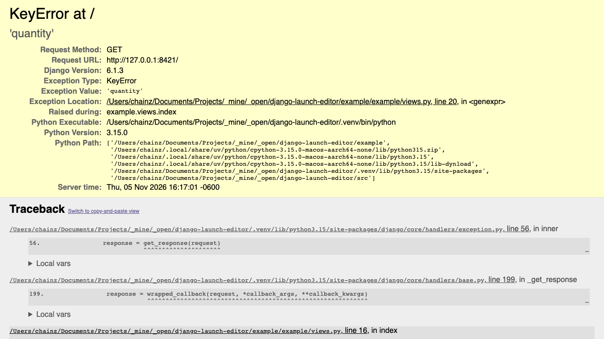
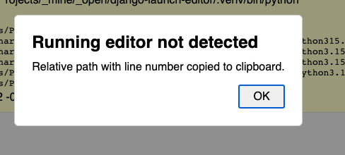
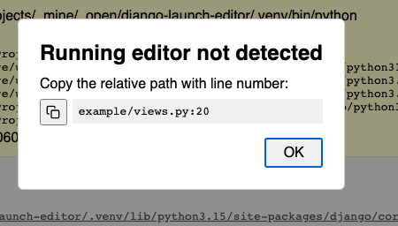

====================
django-launch-editor
====================

.. image:: https://img.shields.io/github/actions/workflow/status/adamchainz/django-launch-editor/main.yml.svg?branch=main&style=for-the-badge
   :target: https://github.com/adamchainz/django-launch-editor/actions?workflow=CI

.. image:: https://img.shields.io/badge/Coverage-100%25-success?style=for-the-badge
   :target: https://github.com/adamchainz/django-launch-editor/actions?workflow=CI

.. image:: https://img.shields.io/pypi/v/django-launch-editor.svg?style=for-the-badge
   :target: https://pypi.org/project/django-launch-editor/

.. image:: https://img.shields.io/badge/code%20style-black-000000.svg?style=for-the-badge
   :target: https://github.com/psf/black

.. image:: https://img.shields.io/badge/pre--commit-enabled-brightgreen?logo=pre-commit&logoColor=white&style=for-the-badge
   :target: https://github.com/pre-commit/pre-commit
   :alt: pre-commit

----

Open files from Django’s debug error page in your editor.

Makes the file locations on Django’s debug error page, like “/path/to/views.py, line 8”, into links that open the file at that line in your editor, using `launch-editor-py <https://github.com/adamchainz/launch-editor-py>`__.

----

**Improve your Django and Git skills** with `my books <https://adamj.eu/books/>`__.

----

Requirements
------------

Python 3.11 to 3.15 supported.

Django 5.2 to 6.1 supported.

Installation
------------

1. Install with **pip**:

   .. code-block:: sh

       python -m pip install django-launch-editor

2. Set Django’s exception reporter class, in your settings file:

   .. code-block:: python

       DEFAULT_EXCEPTION_REPORTER = "django_launch_editor.LaunchEditorExceptionReporter"

   If you already use a custom exception reporter, make it subclass ``LaunchEditorExceptionReporter``.

3. Include the app URLs in your root URLconf:

   .. code-block:: python

       from django.urls import include, path

       urlpatterns = [
           ...,
           path("__launch_editor__/", include("django_launch_editor.urls")),
       ]

   You can use another prefix if required.

That’s it! 🎉

Trigger an error while you have ``DEBUG = True``, and click the file location of any traceback frame, or template error, to open it in your editor.
Where Python knows it, the editor opens at the column of the expression that failed, too.

Editor selection
----------------

django-launch-editor attempts to detect a running non-terminal editor with `launch-editor-py <https://github.com/adamchainz/launch-editor-py>`__.
If none is detected, it falls back to showing a dialog for copying the clicked file path to your clipboard.

Because django-launch-editor runs within the Django server, it can only launch an editor when you run Django on your development machine, not in a container or on a remote server.
Similarly, it must skip terminal editors like Vim, since they would take over the terminal running Django.

For information on how the editor is picked, or how to override it, see `the launch-editor-py documentation <https://github.com/adamchainz/launch-editor-py>`__.

If no editor is found, django-launch-editor falls back to showing a dialog headed “Running editor not detected”, and copying the file location to your clipboard:

The location has the form ``path:line``, such as ``myapp/views.py:8``.

If the browser blocks the automatic copy, the dialog shows a copy icon button to the left of the location:

Security
--------

Opening files runs a program on the server, so the package takes several precautions:

* The whole process only works when ``DEBUG`` is ``True``.

* Links are never added to error emails.

* The view only accepts ``POST`` requests from pages on the same origin, checked with the ``Sec-Fetch-Site`` or ``Origin`` headers that browsers send.
  This blocks cross-site request forgery without relying on ``CsrfViewMiddleware``’s cookie, which may not be set on the error page.

* The view doesn’t accept arbitrary file paths.
  Instead, each link carries a token, signed with your ``SECRET_KEY``, for a file and line that appeared on a debug page.
  Tokens are only made for files that exist, and expire after 24 hours.

Example project
---------------

To try django-launch-editor, there is an example project included in the repository.
Open |the example directory|__, follow the instructions in its README, and try it out.

.. |the example directory| replace:: the ``example/`` directory
__ https://github.com/adamchainz/django-launch-editor/tree/main/example

How it works
------------

``LaunchEditorExceptionReporter`` extends Django’s ``ExceptionReporter`` to add a small script to the HTML debug page, along with signed tokens for each traceback frame.
The script turns file locations into buttons, styled as links, that ``POST`` a token to the view, which checks it and calls ``launch_editor()``.
